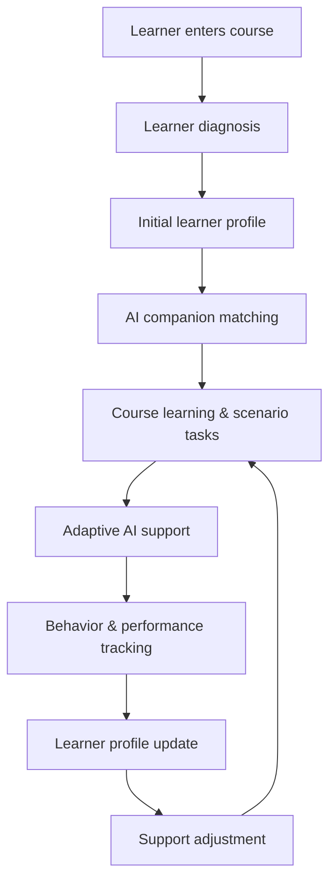
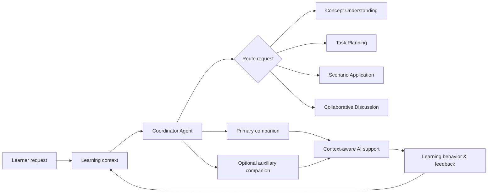

# 知伴学境

### AI-Supported Online Learning Platform

**知伴学境** is an AI-supported online learning platform that provides personalized learning support based on each learner's current needs.

The platform builds an initial learner profile, matches the learner with an appropriate AI companion, supports course learning and scenario-based tasks, tracks learning behavior and task performance, and continuously updates future support.


## Live Demo

**Cloudflare Pages:**  
https://online-learning-platform-d4g.pages.dev


## Overview

Online learners may face different difficulties during the same course:

- difficulty understanding abstract concepts;
- difficulty starting or managing complex tasks;
- difficulty applying knowledge to real-world problems;
- difficulty organizing ideas and participating in discussion.

知伴学境 uses learner profiling, AI companion matching, scenario-based learning, collaboration, and continuous feedback to provide targeted support throughout the learning process.

The core product loop is:

```text
Understand
   ↓
Match
   ↓
Support
   ↓
Observe
   ↓
Adapt
   ↺
```

## How It Works



The learner profile changes with the learner's progress and current support needs.

### Coordinator Routing Layer

AI companion selection is managed by a **Coordinator Agent** rather than relying only on a fixed initial match.

For each learning request, the Coordinator considers the learner's current context, including:

- learner profile;
- current primary companion;
- current chapter and learning content;
- current task or scenario;
- learning cycle and progress;
- recent learning behavior;
- recent conversation history;
- the learner's current question.

The Coordinator then determines:

- the **primary AI companion** for the current request;
- an optional **secondary companion**;
- the reason for the routing decision;
- the support strategy to be used.



The Coordinator uses structured output to make routing decisions explainable and machine-readable:

```json
{
  "selectedAgent": "concept|planner|scenario|discussion",
  "secondaryAgent": "concept|planner|scenario|discussion|null",
  "reason": "routing reason",
  "strategy": "support strategy"
}
```

A rule-based fallback is used when the Coordinator response cannot be parsed reliably.

A fixed set of representative learning requests is also used to evaluate routing performance. In the current prototype, AI companion routing reached **89% accuracy**.

## Key Features

### 1. Learner Profiling

Learners complete a lightweight diagnostic activity before beginning the course.

The platform builds an initial profile across five dimensions:

- learning motivation triggers;
- learning support preferences;
- self-regulation and emotional management;
- perceived learning difficulties;
- cognitive processing preferences.

The learner can review the result, understand the recommendation, and adjust the profile if needed.

### 2. Adaptive AI Learning Companions

The platform includes four AI learning companions:

| AI Companion | Primary Support |
| --- | --- |
| **Concept Understanding Companion** | Concept explanation, examples, misconceptions, knowledge structure |
| **Task Planning Companion** | Task decomposition, progress planning, reminders |
| **Scenario Application Companion** | Case analysis, knowledge transfer, role-based problem solving |
| **Collaborative Discussion Companion** | Idea organization, discussion preparation, reflective questioning |

The system uses a **primary companion + auxiliary support** model.

Learners can receive support from different companions as their needs change across learning activities.

During learning, the **Coordinator Agent** can dynamically route each request to the companion that best matches the learner's current need. This allows the system to move beyond a one-time initial match and provide context-aware support as learning situations change.

### 3. Chapter-Based Learning Environment

Course content is organized by chapter and integrated into one learning workspace.

Learners can also **upload their own textbook PDF**: the platform extracts the text, splits it into chapters automatically (rule-based heading detection, refined by AI), and turns it into a fully usable course with per-chapter reading and Q&A.

The built-in course resources include:

- PPT/PDF materials;
- textbook readings;
- extended resources;
- chapter discussions;
- knowledge Q&A.

AI support is embedded into relevant learning activities and pages.

### 4. RAG-Style Knowledge Q&A

Each chapter has a dedicated knowledge Q&A area. The AI response is constrained by the selected chapter and the corresponding resource index. If the available course materials are insufficient, the system is designed to state that limitation instead of fabricating content.

### 5. Scenario-Based Learning

Learners apply course knowledge to real-world educational problems.

Example scenarios include:

- designing a digital training program for county-level teachers;
- redesigning a low-completion MOOC into a MOOC + SPOC model;
- designing emergency online learning during school closures;
- improving a rural dual-teacher classroom model.

Scenario tasks require learners to analyze problems, apply course concepts, consider multiple stakeholder perspectives, and design practical solutions.

AI provides prompts, examples, planning support, and reflection scaffolds during the task process.

### 6. Collaborative Task Workspace

Scenario tasks can be completed collaboratively.

The prototype includes:

- group discussion;
- shared task writing;
- role-based problem analysis;
- contribution indicators;
- peer interaction;
- AI-supported discussion;
- AI teacher intervention prototypes.

The collaboration design supports explanation, evidence use, negotiation, and collaborative problem solving.

### 7. Continuous Feedback and Adaptive Support

The platform tracks learning process data such as:

- resource usage;
- quiz performance;
- task initiation and progress;
- task revisions;
- discussion participation;
- collaboration behavior;
- AI interaction.

These signals update the learner profile and future support strategy.

```text
Learning data
    ↓
Profile update
    ↓
Support adjustment
    ↓
Learner confirmation
    ↓
Next learning cycle
```

## Product Principles

### Learner First

Learners complete the core thinking, judgment, expression, and task decisions.

AI provides explanation, prompts, questions, planning support, examples, organization support, and feedback.

### Dynamic Learner Profile

The learner profile represents the learner's current state and support needs.

It can change with new learning behavior, task performance, collaboration, and learner feedback.

### Explainable Support

The platform explains:

- what support is recommended;
- why it is recommended;
- what learning evidence contributed to the recommendation.

### Contextual AI Support

Different learning activities trigger different support:

```text
Concept learning
→ Concept support

Task preparation
→ Planning support

Real-world problem solving
→ Scenario application support

Discussion
→ Collaborative discussion support
```

### Learner Control

Learners can:

- review profile results;
- adjust or retake the diagnostic;
- accept or postpone support;
- request more or less AI assistance.

## Tech Stack

- **Frontend:** HTML, CSS, Vanilla JavaScript
- **Local backend:** Node.js native HTTP server
- **AI model:** DeepSeek-compatible Chat Completions API (custom gateway supported)
- **Serverless backend:** Cloudflare Pages Functions (`_worker.js` advanced mode)
- **Deployment:** Cloudflare Pages (https://online-learning-platform-d4g.pages.dev)
- **PDF parsing:** pdf.js (browser-side text extraction)
- **Structured data:** JSON, CSV
- **Client-side persistence:** localStorage (course list, profile) + IndexedDB (uploaded PDFs and chapter texts)
- **Learning resources:** PPT, PDF
- **Documentation:** Markdown

## Multi-Course Support

The platform ships with a built-in course and supports **user-uploaded courses**:

1. Click **＋ 上传我的课程** in the sidebar or course home page;
2. Select a text-based PDF (textbook, lecture notes);
3. The browser extracts text via pdf.js, splits it into chapters by heading rules (第X章 / Chapter N / 一、…), then calls the AI to refine chapter boundaries and generate per-chapter summaries;
4. The uploaded course appears in the sidebar — switch between the default course and uploaded courses at any time;
5. Chapter Q&A on uploaded courses is grounded in the extracted chapter text.

Uploaded files and chapter texts are stored in **IndexedDB** (client-side); course metadata lives in `localStorage`. No server-side storage is involved.

## Project Structure

```text
.
├── index.html
├── package.json
├── netlify.toml          (kept for reference / Netlify-style local proxying)
├── _worker.js            # Cloudflare Pages advanced-mode worker: all AI API routes
│
├── src/
│   ├── app.js
│   └── styles.css
│
├── vendor/
│   ├── pdf.min.mjs
│   └── pdf.worker.min.mjs
│
├── scripts/
│   └── serve.mjs         # local dev server + AI API proxy
│
├── netlify/
│   └── functions/        # original Netlify-format handlers (used by serve.mjs)
│
├── data/
│   ├── knowledge/
│   │   └── knowledge-base.md
│   ├── mappings/
│   │   ├── knowledge-level-mapping.csv
│   │   └── knowledge-trigger-priority.csv
│   ├── rag/
│   │   ├── resourceIndex.json
│   │   └── resourceIndex.example.json
│   └── scenarios/
│       └── scenarios.json
│
├── docs/
│   └── product/
│       ├── product-overview.md
│       └── feature-requirements.md
│
├── resources/
│   └── teaching/
│       ├── lesson-materials/
│       ├── examples/
│       └── references/
│
└── public/
    └── images/
```

### Directory Responsibilities

- `src/` — frontend application code (including multi-course, upload and chapter-splitting logic)
- `_worker.js` — Cloudflare Pages worker handling `/api/*` AI routes in production
- `netlify/functions/` — shared AI prompt / routing logic, proxied by the local dev server
- `data/` — structured data used by the application and AI generation pipeline
- `resources/` — source course materials and learning assets
- `docs/` — product and feature documentation
- `public/` — static frontend assets
- `vendor/` — vendored pdf.js for offline-safe browser-side PDF parsing

## Product Documentation

- [Product Overview](docs/product/product-overview.md)
- [Feature Requirements](docs/product/feature-requirements.md)

## Local Development

Clone the repository:

```bash
git clone https://github.com/hdhhduehdwbdf/online-learning-platform.git
cd online-learning-platform
```

Start the local server (no dependencies to install — requires Node 18+):

```bash
npm run start
```

Default local address:

```text
http://localhost:5174
```

To use a different port:

```bash
PORT=5176 node scripts/serve.mjs
```

## Local Development

Clone the repository:

```bash
git clone https://github.com/hdhhduehdwbdf/online-learning-platform.git
cd online-learning-platform
```

Start the local server (no dependencies to install — plain Node 18+):

```bash
npm run start
```

Default local address:

```text
http://localhost:5174
```

To use a different port:

```bash
PORT=5176 node scripts/serve.mjs
```

## AI Configuration

AI requests are routed through the local backend or the Cloudflare worker so the API key stays on the server side. Both support any OpenAI-compatible Chat Completions endpoint.

Create a local environment file based on `.env.example`:

```text
DEEPSEEK_API_KEY=your_api_key
DEEPSEEK_MODEL=deepseek-chat
DEEPSEEK_BASE_URL=https://api.deepseek.com
```

- `DEEPSEEK_BASE_URL` — optional; defaults to DeepSeek official. Point it at any OpenAI-compatible gateway (e.g. `https://your-gateway.example/v1`).
- `DEEPSEEK_MODEL` — model name; reasoning-style models work (the chapter-refine call budgets extra tokens for reasoning).

Restart the local server after updating environment variables.

For Cloudflare Pages deployment, set the same variables as encrypted secrets:

```bash
npx wrangler pages secret put DEEPSEEK_API_KEY --project-name online-learning-platform
npx wrangler pages secret put DEEPSEEK_MODEL --project-name online-learning-platform
npx wrangler pages secret put DEEPSEEK_BASE_URL --project-name online-learning-platform
```

## Deployment

The production site runs on **Cloudflare Pages** with `_worker.js` (advanced mode):

- static assets are served from the project root;
- `/api/deepseek`, `/api/agent-chat`, `/api/coordinator-chat`, `/api/section-chat` are handled by `_worker.js`, which reuses the same prompts and coordinator routing logic as the local server.

To deploy an update manually:

```bash
npx wrangler pages deploy . --project-name online-learning-platform --branch main
```

(Keep large files out of the deploy directory — Cloudflare Pages caps assets at 25 MiB each; see `.wranglerignore` / deploy excludes.)

The repository also keeps `netlify.toml` and `netlify/functions/` so the same handlers can run on Netlify if needed: `/api/*` maps to `/.netlify/functions/*` there.

## Security

- Never commit `.env.local`.
- Never expose API keys in frontend JavaScript.
- Route external AI requests through server-side or serverless functions.
- Rotate any key that may have been exposed.

## Current Status

This project is a **functional product prototype**.

The current version demonstrates the complete flow from learner diagnosis and AI companion matching to scenario-based learning, collaborative tasks, and feedback-driven profile updates. It also supports **uploading any textbook PDF and learning it chapter by chapter** with AI-split structure and grounded chapter Q&A.

Some analytics and collaboration behaviors are currently simulated or stored through `localStorage`.

Future development may include:

- persistent user authentication;
- database-backed learner profiles;
- production collaboration infrastructure;
- semantic/vector retrieval for course resources;
- more robust learning analytics;
- teacher-facing analytics dashboards;
- server-side course storage shared across devices.
